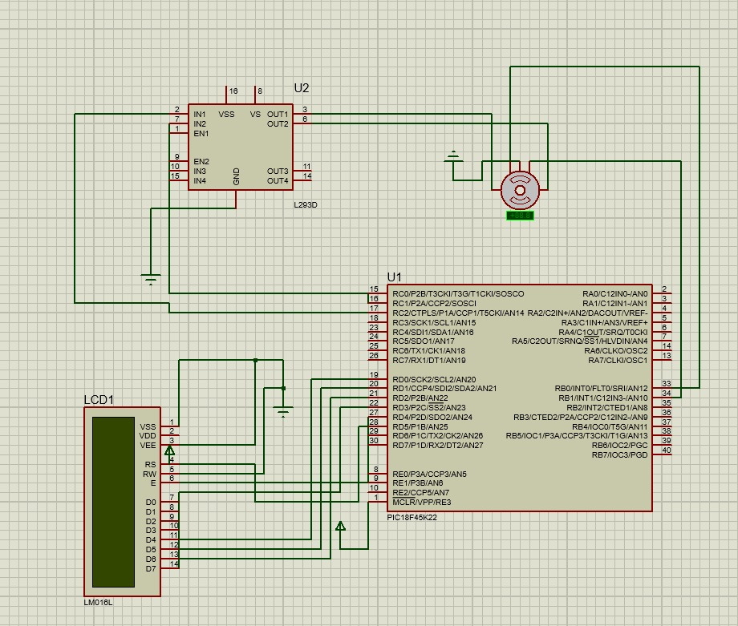
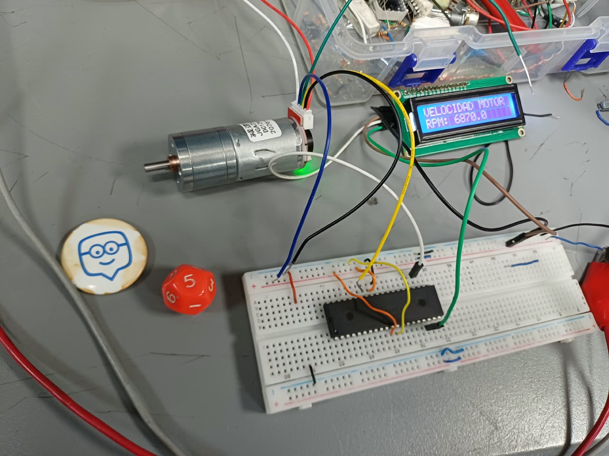

# Práctica 5: Medición de velocidad de un motor con encoder y pantalla LCD I2C

## Integrantes

- **Jareth Santiago Escamilla Marquez** - [@jarethescamilla](https://github.com/jarethescamilla)
- **Diego Alexander Baron Pacheco** - [@DiegoBp777](https://github.com/DiegoBp777)
- **Fredy Vicente Patiño Garzon** - [@fredyvipatinoga-crypto](https://github.com/fredyvipatinoga-crypto)

---

## Tabla de contenido

1. [Introducción](#1-introducción)
2. [Planteamiento del problema](#2-planteamiento-del-problema)
3. [Objetivos](#3-objetivos)
4. [Materiales y herramientas](#4-materiales-y-herramientas)
5. [Marco teórico](#5-marco-teórico)
6. [Diseño y conexiones del circuito](#6-diseño-y-conexiones-del-circuito)
7. [Funcionamiento del programa](#7-funcionamiento-del-programa)
8. [Algoritmo](#8-algoritmo)
9. [Código fuente](#9-código-fuente)
10. [Evidencias](#10-evidencias)
11. [Dificultades y soluciones](#11-dificultades-y-soluciones)
12. [Análisis de resultados](#12-análisis-de-resultados)
13. [Conclusiones](#13-conclusiones)

---

## 1. Introducción

En esta práctica se desarrolló un sistema electrónico para medir y visualizar la velocidad de giro de un motor de corriente continua (DC), utilizando un microcontrolador PIC18F45K22, un motor con encoder integrado y una pantalla LCD de 16×2 caracteres con comunicación I2C.

El sistema utiliza la señal generada por el encoder para registrar los pulsos asociados al movimiento del motor. Estos pulsos son detectados por el microcontrolador mediante una interrupción externa configurada en el pin RB0/INT0. Posteriormente, el programa procesa los pulsos registrados durante un intervalo de tiempo y calcula una estimación de la velocidad del motor en revoluciones por minuto (RPM).

La información calculada se presenta en una pantalla LCD conectada mediante un módulo I2C. Además, se implementó una condición de alerta que cambia el mensaje mostrado cuando la velocidad calculada supera el límite programado de 7000 RPM.

La práctica permitió aplicar conocimientos sobre programación en C, configuración de microcontroladores, interrupciones externas, lectura de sensores, comunicación I2C y visualización de información en tiempo real.

## 2. Planteamiento del problema

Se requiere diseñar e implementar un sistema capaz de medir la velocidad de giro de un motor DC y presentar la información en una pantalla LCD de 16×2 caracteres.

Para ello, se utiliza un encoder que genera pulsos eléctricos durante la rotación del motor. El PIC18F45K22 debe detectar dichos pulsos mediante una interrupción externa, contabilizarlos durante un intervalo de tiempo y utilizar la información obtenida para calcular la velocidad en revoluciones por minuto.

Adicionalmente, el sistema debe mostrar un mensaje de alerta cuando la velocidad calculada supere un límite establecido de 7000 RPM. Cuando la velocidad vuelva a estar dentro del límite, la pantalla debe regresar a la visualización normal.

El reto principal consiste en integrar correctamente el motor, el encoder, el microcontrolador y la pantalla LCD, garantizando la adquisición de los pulsos, el procesamiento de los datos y la presentación de la información.

## 3. Objetivos

### 3.1. Objetivo general

Implementar un sistema de medición y visualización de velocidad para un motor DC con encoder, utilizando el PIC18F45K22 y una pantalla LCD de 16×2 con comunicación I2C.

### 3.2. Objetivos específicos

- Configurar el PIC18F45K22 para trabajar con su oscilador interno a 8 MHz.
- Utilizar la interrupción externa INT0 para detectar los pulsos del encoder.
- Contabilizar los pulsos generados durante un intervalo de muestreo.
- Calcular la velocidad estimada del motor en revoluciones por minuto.
- Configurar la comunicación I2C entre el microcontrolador y la pantalla LCD.
- Mostrar la velocidad calculada en la pantalla.
- Implementar una condición de alerta para indicar una velocidad superior al límite programado.
- Verificar el funcionamiento del sistema mediante el montaje físico y las pruebas realizadas.

## 4. Materiales y herramientas

- Microcontrolador PIC18F45K22.
- Motor DC con caja reductora y encoder integrado JGA25-370 de 12 V y 60 RPM nominales.
- Pantalla LCD de 16×2 caracteres.
- Módulo de comunicación I2C para LCD, basado en PCF8574 o compatible.
- Fuente de alimentación de 12 V para el motor.
- Alimentación regulada de 5 V para el microcontrolador y el encoder, de acuerdo con sus especificaciones.
- Protoboard.
- Cables de conexión.
- Resistencias y elementos de polarización requeridos por el circuito.
- Computador.
- MPLAB X IDE.
- Compilador XC8.
- Herramientas de simulación y programación utilizadas durante el desarrollo.

## 5. Marco teórico

### 5.1. Microcontrolador PIC18F45K22

El PIC18F45K22 es un microcontrolador de 8 bits que permite procesar señales digitales, ejecutar instrucciones programadas y controlar diferentes dispositivos electrónicos.

En esta práctica se encarga de recibir los pulsos del encoder, calcular la velocidad del motor y enviar los resultados a la pantalla LCD.

### 5.2. Motor DC con encoder

Un motor de corriente continua convierte energía eléctrica en movimiento rotacional. En este caso se utilizó un motor JGA25-370 con caja reductora y encoder integrado.

La caja reductora permite disminuir la velocidad del eje de salida y aumentar el par disponible. El encoder proporciona señales eléctricas que permiten detectar el movimiento del motor y calcular una estimación de su velocidad.

La velocidad nominal indicada para el motor utilizado es de 60 RPM. Sin embargo, la velocidad real puede variar según la carga, la alimentación y las condiciones de funcionamiento.

### 5.3. Encoder óptico

Un encoder óptico es un sensor que convierte el movimiento de un eje en señales eléctricas. El encoder integrado en el motor genera pulsos que pueden ser contabilizados por el microcontrolador.

Cada pulso representa un evento asociado a la rotación del eje. Al conocer el número de pulsos por revolución y el intervalo de medición, es posible estimar la velocidad angular.

En esta práctica se utiliza inicialmente la señal A del encoder. La segunda señal puede emplearse posteriormente para identificar el sentido de giro.

### 5.4. Interrupciones externas

Una interrupción permite que el microcontrolador responda a un evento sin tener que consultar continuamente el estado de una entrada.

El PIC18F45K22 dispone de una interrupción externa denominada INT0, asociada al pin RB0. En el programa se configura para detectar un flanco ascendente de la señal del encoder.

Cada vez que se detecta un flanco válido, se ejecuta la rutina de interrupción y se incrementa la variable `pulsos`.

### 5.5. Cálculo de la velocidad

La velocidad de rotación se expresa en revoluciones por minuto (RPM). Para calcularla se utiliza la cantidad de pulsos detectados, el número de pulsos por revolución y el tiempo de medición.

La fórmula general es:

$$
RPM = \frac{Pulsos \times 60}{PPR \times Tiempo}
$$

Donde:

RPM: revoluciones por minuto del motor.

Pulsos: cantidad de pulsos registrados durante la medición.

PPR: cantidad de pulsos por revolución del eje medido.

Tiempo: duración de la medición en segundos.

En el programa se utiliza un intervalo de muestreo de 400 ms y un factor de 5 pulsos por revolución. Por tanto, el cálculo implementado es:

$$
RPM = \frac{Pulsos\ medidos \times 60000}{5 \times 400}
$$

La expresión equivale a:

$$
RPM = Pulsos\ medidos \times 30
$$

Este factor corresponde a la calibración utilizada en el código. Para obtener RPM reales del eje de salida, debe verificarse experimentalmente que el valor de 5 pulsos por revolución sea el adecuado para el montaje.

### 5.6. Comunicación I2C

I2C es un protocolo de comunicación serial que utiliza dos líneas principales:

- **SDA:** transmisión de datos.
- **SCL:** señal de reloj.

El módulo adaptador I2C permite controlar la pantalla LCD mediante estas dos líneas, reduciendo la cantidad de pines necesarios del microcontrolador.

En esta práctica se utilizan los pines RC4/SDA y RC3/SCL del PIC18F45K22. El programa utiliza la dirección de escritura `0x4E`, correspondiente a la dirección I2C de 7 bits `0x27` desplazada una posición a la izquierda.

### 5.7. Sistema de alerta por sobrevelocidad

El programa incorpora una bandera lógica denominada `bandera_alerta`, que permite identificar si la velocidad calculada supera el límite establecido.

Cuando las RPM son mayores que 7000, el programa muestra los mensajes:

```text
!ALERTA MOTOR!
SOBREVELOCIDAD!
```

Mientras la alerta permanece activa, el programa continúa tomando muestras de la velocidad. Cuando el valor calculado desciende a 7000 RPM o menos, la bandera se desactiva y la pantalla vuelve a mostrar la velocidad normal.

Este mecanismo corresponde a una alerta por software y no a un sistema de protección eléctrica que desconecte físicamente el motor.

## 6. Diseño y conexiones del circuito

### 6.1. Conexión del motor y el encoder

El motor utilizado dispone de seis cables. La distribución de referencia utilizada para el montaje es la siguiente:

| Cable | Función | Conexión |
|---|---|---|
| Rojo | Terminal positivo del motor | Alimentación del motor o terminal del controlador |
| Blanco | Terminal negativo del motor | Terminal correspondiente del controlador o negativo de la alimentación en una prueba directa |
| Azul | Alimentación positiva del encoder | +5 V regulados, si coincide con la especificación del módulo |
| Negro | Tierra del encoder | GND |
| Amarillo | Señal A del encoder | RB0/INT0 |
| Verde | Señal B del encoder | Sin conectar en la versión inicial |

La distribución de cables debe verificarse con la documentación de la versión específica del motor antes de energizarlo.

**Precaución:** los 12 V se utilizan para el motor, no para la alimentación del encoder. No se deben aplicar 12 V a los cables azul, negro, amarillo o verde.

Si se utiliza un controlador de motor, los cables rojo y blanco deben conectarse a sus terminales de salida. El PIC no debe alimentar directamente el motor desde sus pines de salida.

### 6.2. Conexión del encoder al PIC18F45K22

| Señal | Pin del PIC | Función |
|---|---|---|
| Encoder A, cable amarillo | RB0/INT0, pin 33 | Entrada de pulsos |
| Encoder B, cable verde | Sin conectar inicialmente | Señal auxiliar |
| Alimentación del encoder, cable azul | +5 V regulados, si corresponde | Alimentación del sensor |
| GND del encoder, cable negro | GND común | Referencia eléctrica |

La entrada RB0 debe recibir una señal digital compatible con los niveles eléctricos del PIC. Si la salida del encoder requiere una resistencia pull-up, esta debe seleccionarse de acuerdo con la documentación del sensor.

### 6.3. Conexión de la pantalla LCD I2C

| Pin del módulo LCD | Conexión al PIC18F45K22 |
|---|---|
| GND | GND común |
| VCC | +5 V |
| SDA | RC4, pin 23 |
| SCL | RC3, pin 18 |

La dirección configurada en el programa es `0x4E` para el byte de escritura. Esta corresponde a la dirección I2C de 7 bits `0x27`.

### 6.4. Alimentación del sistema

El PIC y el encoder deben contar con una alimentación adecuada y una referencia eléctrica común. Si el motor utiliza una fuente independiente, se debe verificar el esquema de conexión y establecer la referencia común necesaria para la lectura de la señal del encoder.

El motor no debe alimentarse directamente desde el microcontrolador.

## 7. Funcionamiento del programa

El programa desarrollado en MPLAB X IDE se divide en varias etapas.

### 7.1. Configuración inicial

Se establece el oscilador interno del PIC a 8 MHz y se configuran los puertos utilizados por el encoder y la pantalla LCD.

### 7.2. Inicialización de I2C y LCD

Se configura el módulo MSSP del microcontrolador para trabajar como maestro I2C. Después se inicializa la pantalla LCD en modo de cuatro bits y se muestra el mensaje inicial `VELOCIDAD MOTOR`.

### 7.3. Conteo de pulsos

La interrupción INT0 detecta los flancos ascendentes de la señal del encoder conectada a RB0. Cada interrupción incrementa la variable `pulsos`.

### 7.4. Medición de velocidad

El programa espera 400 ms y toma una copia de los pulsos registrados. Para evitar que la interrupción modifique el contador durante la lectura, se desactivan temporalmente las interrupciones globales.

Posteriormente, el contador se reinicia para comenzar una nueva ventana de medición.

### 7.5. Cálculo de RPM

El programa utiliza la expresión:

$$
RPM = \frac{Pulsos\ medidos \times 60000}{5 \times 400}
$$

El factor de cinco pulsos por revolución corresponde al valor utilizado en el código definitivo. Su validez debe comprobarse mediante la calibración del encoder.

### 7.6. Visualización normal

Cuando la velocidad calculada no supera el límite, la pantalla presenta:

```text
VELOCIDAD MOTOR
RPM: valor
```

La variable `rpm` se convierte en texto mediante `sprintf()` para mostrar el resultado con un decimal.

### 7.7. Alerta de sobrevelocidad

Si la velocidad calculada supera 7000 RPM, se activa `bandera_alerta` y se muestran los mensajes de advertencia en las dos líneas del LCD.

El programa continúa midiendo los pulsos y mantiene la alerta hasta que el valor calculado desciende a 7000 RPM o menos. En ese momento, vuelve a la pantalla normal.

## 8. Algoritmo

### 8.1. Entradas, proceso y salidas

**Entradas:**

- Pulsos del encoder mediante RB0/INT0.
- Alimentación del motor y del encoder.

**Proceso:**

- Configurar el oscilador y los puertos.
- Inicializar la comunicación I2C y la pantalla LCD.
- Contar los pulsos del encoder mediante interrupciones.
- Medir los pulsos durante intervalos de 400 ms.
- Calcular la velocidad estimada en RPM.
- Comparar el resultado con el límite de 7000 RPM.
- Actualizar la pantalla de acuerdo con el estado del sistema.

**Salidas:**

- Visualización de la velocidad estimada en RPM.
- Mensaje de alerta cuando la velocidad calculada supera el límite programado.

### 8.2. Pseudocódigo

```text
INICIO

Configurar oscilador a 8 MHz
Configurar RB0 como entrada digital
Configurar interrupcion INT0
Inicializar comunicacion I2C
Inicializar pantalla LCD

Mostrar "VELOCIDAD MOTOR"

MIENTRAS el sistema este funcionando HACER

    Esperar 400 ms

    Deshabilitar temporalmente las interrupciones

    Guardar pulsos acumulados
    Reiniciar contador de pulsos

    Habilitar las interrupciones

    Calcular RPM

    SI RPM > 7000 ENTONCES

        Activar bandera de alerta

        Mostrar "!ALERTA MOTOR!"
        Mostrar "SOBREVELOCIDAD!"

        MIENTRAS RPM > 7000 HACER

            Esperar 400 ms
            Medir nuevos pulsos
            Calcular RPM

        FIN MIENTRAS

        Desactivar bandera de alerta

    SINO

        Mostrar "VELOCIDAD MOTOR"
        Mostrar RPM en pantalla

    FIN SI

FIN MIENTRAS

FIN
```

## 9. Código fuente

El siguiente código corresponde al programa definitivo utilizado en el montaje físico.

```c
#pragma config FOSC = INTIO67  // Oscilador interno activado
#pragma config WDTEN = OFF     // Perro guardian desactivado
#pragma config LVP = OFF       // Programacion en bajo voltaje desactivada

#define _XTAL_FREQ 8000000     // Frecuencia del oscilador a 8MHz

#include <xc.h>               // Libreria principal del microcontrolador PIC
#include <stdio.h>            // Libreria para formatear cadenas de texto
#include <stdbool.h>          // Libreria para usar tipo de dato booleano

#define I2C_ADDR 0x4E         // Direccion I2C de escritura del PCF8574

#define LCD_BACKLIGHT 0x08    // Bit para encender la luz de fondo del LCD
#define ENABLE 0x04           // Bit para enviar pulso de habilitacion (E)
#define RS 0x01               // Bit para seleccion de registro

volatile unsigned int pulsos = 0;
float rpm = 0.0;
bool bandera_alerta = false;
char buffer_lcd[16];

void I2C_Init(void) {
    ANSELCbits.ANSC3 = 0;
    ANSELCbits.ANSC4 = 0;
    TRISCbits.TRISC3 = 1;
    TRISCbits.TRISC4 = 1;
    SSP1CON1 = 0x28;
    SSP1ADD = 19;
}

void I2C_Start(void) {
    SSP1CON2bits.SEN = 1;
    while (SSP1CON2bits.SEN);
}

void I2C_Stop(void) {
    SSP1CON2bits.PEN = 1;
    while (SSP1CON2bits.PEN);
}

void I2C_Write(unsigned char data) {
    SSP1BUF = data;
    while (SSP1STATbits.BF);
    while ((SSP1CON2 & 0x1F) || (SSP1STATbits.R_nW));
}

void LCD_I2C_Write(unsigned char data) {
    I2C_Start();
    I2C_Write(I2C_ADDR);
    I2C_Write(data | LCD_BACKLIGHT);
    I2C_Stop();
}

void LCD_PulseEnable(unsigned char data) {
    LCD_I2C_Write(data | ENABLE);
    __delay_us(1);
    LCD_I2C_Write(data & ~ENABLE);
    __delay_us(50);
}

void LCD_SendNibble(unsigned char nibble, unsigned char mode) {
    unsigned char data = (nibble & 0xF0) | mode;
    LCD_I2C_Write(data);
    LCD_PulseEnable(data);
}

void LCD_SendByte(unsigned char byte, unsigned char mode) {
    LCD_SendNibble(byte & 0xF0, mode);
    LCD_SendNibble((byte << 4) & 0xF0, mode);
}

void LCD_Cmd(unsigned char cmd) {
    LCD_SendByte(cmd, 0);
}

void LCD_Char(char data) {
    LCD_SendByte(data, RS);
}

void LCD_Init(void) {
    __delay_ms(50);
    LCD_SendNibble(0x30, 0);
    __delay_ms(5);
    LCD_SendNibble(0x30, 0);
    __delay_us(150);
    LCD_SendNibble(0x30, 0);
    LCD_SendNibble(0x20, 0);
    LCD_Cmd(0x28);
    LCD_Cmd(0x0C);
    LCD_Cmd(0x01);
    __delay_ms(2);
}

void LCD_SetCursor(unsigned char row, unsigned char col) {
    unsigned char pos = (row == 1)
                      ? (0x80 + col - 1)
                      : (0xC0 + col - 1);
    LCD_Cmd(pos);
}

void LCD_Print(const char *str) {
    while (*str) {
        LCD_Char(*str++);
    }
}

void __interrupt() ISR_Encoder(void) {
    if (INTCONbits.INT0IF) {
        pulsos++;
        INTCONbits.INT0IF = 0;
    }
}

void System_Init(void) {
    OSCCON = 0x62;
    ANSELBbits.ANSB0 = 0;
    TRISBbits.TRISB0 = 1;
    INTCON2bits.INTEDG0 = 1;
    INTCONbits.INT0IF = 0;
    INTCONbits.INT0IE = 1;
    INTCONbits.GIE = 1;
}

void main(void) {
    unsigned int pulsos_medidos = 0;

    System_Init();
    I2C_Init();
    LCD_Init();

    LCD_SetCursor(1, 1);
    LCD_Print("VELOCIDAD MOTOR ");

    while (1) {
        // Lectura y calculo de RPM
        __delay_ms(400);

        INTCONbits.GIE = 0;
        pulsos_medidos = pulsos;
        pulsos = 0;
        INTCONbits.GIE = 1;

        rpm = (pulsos_medidos * 60000.0) / (5.0 * 400.0);

        // Activacion de la alerta de sobrevelocidad
        if (rpm > 7000.0) {
            bandera_alerta = true;
        } else {
            bandera_alerta = false;
        }

        // Mostrar informacion en la pantalla
        if (bandera_alerta) {
            LCD_Cmd(0x01);
            __delay_ms(2);

            LCD_SetCursor(1, 1);
            LCD_Print("!ALERTA MOTOR!  ");

            LCD_SetCursor(2, 1);
            LCD_Print("SOBREVELOCIDAD! ");

            while (bandera_alerta) {
                __delay_ms(400);

                INTCONbits.GIE = 0;
                pulsos_medidos = pulsos;
                pulsos = 0;
                INTCONbits.GIE = 1;

                rpm = (pulsos_medidos * 60000.0)
                      / (5.0 * 400.0);

                if (rpm <= 7000.0) {
                    bandera_alerta = false;
                }
            }

            LCD_Cmd(0x01);
            __delay_ms(2);

        } else {
            LCD_SetCursor(1, 1);
            LCD_Print("VELOCIDAD MOTOR ");

            LCD_SetCursor(2, 1);
            sprintf(buffer_lcd, "RPM: %-10.1f", rpm);
            LCD_Print(buffer_lcd);
        }
    }
}
```

### 9.1. Descripción de las funciones principales

| Función o variable | Descripción |
|---|---|
| `I2C_Init()` | Configura el módulo MSSP para la comunicación I2C. |
| `LCD_Init()` | Inicializa la pantalla LCD en modo de cuatro bits. |
| `LCD_SetCursor()` | Ubica el cursor en la fila y columna solicitadas. |
| `LCD_Print()` | Envía una cadena de caracteres a la pantalla. |
| `ISR_Encoder()` | Cuenta los pulsos recibidos por INT0. |
| `System_Init()` | Configura el oscilador, RB0 y las interrupciones. |
| `pulsos` | Almacena los pulsos detectados durante el muestreo. |
| `rpm` | Guarda el resultado del cálculo de velocidad. |
| `bandera_alerta` | Indica si se ha superado el límite programado. |
| `buffer_lcd` | Almacena el texto formateado para mostrar las RPM. |

## 10. Evidencias

En esta sección se muestran las conexiones, funcionamiento del sistema y Simulacion.

### 10.1. Simulacion

Se presenta la simulación usando el  PIC18F45K22.



### 10.2. Circuito completo

Se muestra la integración del PIC18F45K22, el motor con encoder y la pantalla LCD I2C.



## 11. Dificultades y soluciones

### 11.1. Identificación de los cables del motor

El motor posee cables para la alimentación y para las señales del encoder. Fue necesario diferenciar los terminales que alimentan el motor de aquellos utilizados por el sensor para evitar conexiones incorrectas.

La solución consiste en verificar el pinout de la versión específica del motor antes de realizar las conexiones.

### 11.2. Configuración de la comunicación I2C

Para mostrar información en la pantalla LCD fue necesario configurar el módulo MSSP del PIC y establecer la dirección I2C correspondiente al expansor PCF8574.

También fue importante identificar correctamente las líneas SDA y SCL y comprobar la alimentación del módulo.

### 11.3. Detección de los pulsos

La lectura de la velocidad depende de la detección correcta de los pulsos del encoder. Se configuró INT0 para detectar los flancos ascendentes de la señal conectada a RB0.

Esta configuración permite contar los pulsos mediante una rutina de interrupción, aunque es necesario verificar que la señal tenga niveles lógicos adecuados y que no existan pulsos perdidos.

### 11.4. Cálculo de RPM

El programa utiliza un intervalo de 400 ms y un factor de cinco pulsos por revolución. Si ese factor no coincide con el PPR real del eje de salida, la velocidad mostrada presentará un error sistemático.

Por ello, la calibración del encoder es un paso importante para obtener mediciones confiables.

### 11.5. Visualización de la alerta

Se incorporó una bandera lógica para distinguir el estado normal del estado de sobrevelocidad. Mientras la condición de alerta está activa, el programa sigue midiendo la velocidad y comprueba si el valor calculado vuelve al rango permitido.

La alerta se realiza mediante mensajes en pantalla y no desconecta automáticamente la alimentación del motor.

## 12. Análisis de resultados

La implementación permite integrar la detección de pulsos de un encoder con el procesamiento de datos y la visualización en una pantalla LCD I2C.

El uso de la interrupción externa INT0 permite contabilizar los flancos de la señal del encoder. El programa toma muestras cada 400 ms y utiliza los pulsos acumulados para calcular una estimación de velocidad.

La pantalla LCD presenta el mensaje `VELOCIDAD MOTOR` y el resultado numérico de RPM. Además, el programa incorpora una condición de alerta cuando el cálculo supera 7000 RPM, sustituyendo temporalmente la información normal por un mensaje de sobrevelocidad.

La interpretación de los resultados requiere tener en cuenta que el cálculo depende del factor de conversión configurado. En este programa se utiliza un valor de cinco pulsos por revolución, que debe validarse para el encoder y el eje de salida empleados.

Asimismo, la indicación nominal de 60 RPM del motor no significa que el programa deba mostrar siempre ese valor: la velocidad puede variar según la carga y la alimentación. Para determinar el error de medición se debe comparar la lectura del LCD con un instrumento o método independiente de medición de velocidad.

En general, la práctica permite comprender el funcionamiento conjunto del sensor, el microcontrolador y la interfaz de visualización, así como la importancia de validar experimentalmente los parámetros de cálculo.

## 13. Conclusiones

- Se desarrolló un sistema de medición de velocidad para un motor DC con encoder integrado, utilizando el PIC18F45K22 como unidad de procesamiento.
- Se aplicaron interrupciones externas para registrar los pulsos del encoder mediante el pin RB0/INT0.
- Se implementó un cálculo de velocidad en RPM basado en los pulsos acumulados durante un intervalo de 400 ms.
- Se integró una pantalla LCD de 16×2 mediante comunicación I2C, utilizando los pines RC3/SCL y RC4/SDA del microcontrolador.
- Se incorporó una condición de alerta por software para indicar cuando la velocidad calculada supera el límite programado de 7000 RPM.
- Se identificó la importancia de configurar correctamente la alimentación del motor y del encoder, así como de verificar los niveles lógicos de la señal.
- Se concluyó que la precisión de la lectura depende de la correcta calibración de los pulsos por revolución del eje de salida. Por ello, el factor utilizado en el programa debe verificarse experimentalmente antes de considerar las RPM como una medición exacta.

En conclusión, la práctica permitió aplicar conceptos de programación de microcontroladores, interrupciones, sensores ópticos y comunicación I2C para construir un sistema de monitoreo de velocidad. También permitió reconocer que la integración del hardware y el software debe acompañarse de pruebas y calibración para asegurar la confiabilidad de los resultados.
